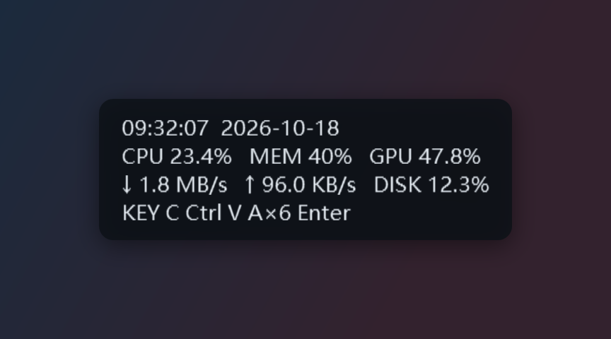
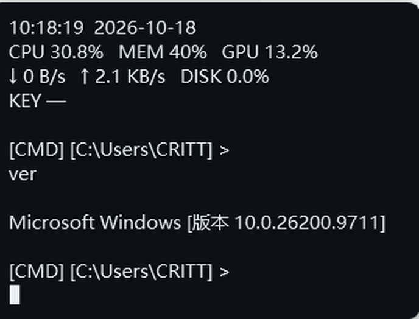

<h1 align="center">Overlay Information with CMD</h1>

<p align="center">
  <b>始终置顶的桌面信息叠层：实时硬件数据、按键显示，按 <code>F9</code> 还能直接在叠层里敲命令。</b><br>
  <sub>An always-on-top desktop overlay with live hardware stats, keystroke display and a built-in command line.</sub>
</p>

<p align="center">
  
  
  
  
</p>

<p align="center">
  
</p>

鼠标默认**完全穿透**，不挡任何点击；所有内容、样式和行为都在设置窗口里可视化调整。

## ✨ 功能

- **实时数据** — CPU / GPU / 磁盘 / 网络 / 内存 / 分区空间 / 时间，PDH 性能计数器采样，独立线程不卡 UI
- **自定义文本** — 模板化占位符 `{cpu:0.0}%`，支持 .NET 格式串与对齐，内置 6 套预设模板
- **按键显示** — 全局键盘钩子，最近按键、重复折叠（`A×6`）、最大字符数限制
- **快捷命令行** — `F9` 在信息栏下方执行 CMD / PowerShell / 自定义命令，返回原样打印
- **启动动画** — 打字 / 退格动画 + 模拟光标（方块 / 竖线 / 下划线 / 空心框 / 关闭）
- **外观可调** — 文字描边、背景图片、固定宽度、圆角、透明度、字体字号，尺寸只增不减不跳动
- **托盘常驻** — 单实例唤醒、开机自启、可自定义的全局热键、鼠标穿透锁定
- **无依赖** — 单文件 exe，目标机器不需要安装 .NET

## 🚀 快速开始

**下载即用**：到 [Releases](https://github.com/CRITTIof/overlay-information-with-cmd/releases) 下载
`WindowOverlay-x64.exe`（普通电脑）或 `WindowOverlay-arm64.exe`（Windows on ARM），放到任意本地目录双击运行。

**从源码运行**：

```bat
git clone https://github.com/CRITTIof/overlay-information-with-cmd.git
cd overlay-information-with-cmd
run.bat
```

`run.bat` 会自动编译，并把程序部署到 `%LOCALAPPDATA%\Programs\WindowOverlay` 后启动。

> **不要从受限目录直接运行**（AI 工作区、沙箱、某些受管文件夹）。从那里启动的进程会被降权到
> **Low 完整性级别**，Windows 随后会拒绝托盘图标、全局热键和键盘钩子。程序启动时会把完整性级别
> 写进日志，发现受限会弹窗提示。

## ⌨️ 快捷键

| 操作 | 默认 | 说明 |
| --- | --- | --- |
| 打开 / 关闭快捷命令行 | `F9` | 见下一节 |
| 打开设置窗口 | `F10` | 也可左键单击托盘图标 |
| 锁定 / 解锁（鼠标穿透） | `F8` | 解锁后可拖动、右键菜单、双击设置 |
| 显示 / 隐藏叠层 | *未设置* | 从托盘菜单操作，或自行绑定 |

所有热键都能在「设置 → 热键」里改，**留空 = 不启用**；被其它程序占用时会自动退到 `Ctrl+Alt+原键`。
再次双击 exe 不会起第二个进程，而是唤醒已在运行的实例的设置窗口。

## 🖥️ 快捷命令行（`F9`）



按 `F9` 后会在信息栏下方另起三行：一个空行、提示符 `[CMD] [C:\Users\CRITT] >`、以及输入行。

- 提示符格式为 `[工具] [工作目录] >`，工具名统一大写，PowerShell 显示为 **PWSH**
- 工具可选 **CMD**（默认）/ **Windows PowerShell** / **PowerShell 7** / **自定义模板**（`{cmd}` 占位）
- 命令在后台线程执行，返回内容**原样打印**，然后给出新提示符，可连续执行多条
- 单行过长时只保留**后面** N 个字符并加 `…`（可关闭），也可限制最多保留多少行
- 默认 20 秒超时，超时强制结束；输出先按 UTF-8 解码，失败退回系统 OEM 代码页（中文不乱码）
- **再按 `F9`（或 `Esc`）退出**，清空命令与返回，恢复正常信息显示
- 启动动画期间、叠层隐藏时该热键不生效

输入框里的输入法被刻意关闭，保证命令按原样输入；支持方向键、`Home` / `End`、`Ctrl+V`、`Ctrl+Z`。

## 🧩 显示内容与占位符

内容是一段支持多行的模板文本，用 `{变量}` 插入实时数据：

```
CPU {cpu:0.0}%      →  CPU 23.4%
MEM {mem_pct:0}%    →  MEM 40%
{net_down,>10}      →  右对齐到 10 个字符
```

| 变量 | 含义 | 变量 | 含义 |
| --- | --- | --- | --- |
| `{cpu}` / `{cpu_bar}` | CPU 占用 / 进度条 | `{gpu}` / `{gpu_bar}` | GPU 占用 / 进度条 |
| `{mem_pct}` `{mem_used}` `{mem_total}` `{mem_free}` | 内存 | `{gpu_name}` `{gpu_temp}` `{gpu_power}` | 显卡名 / 温度 / 功耗 |
| `{disk}` / `{disk_bar}` | 磁盘活动率 | `{vram_used}` `{vram_total}` `{vram_pct}` | 显存 |
| `{disk_read}` `{disk_write}` | 磁盘读写速度 | `{free_C}` `{total_C}` `{used_pct_C}` | 分区空间（`D` 即 D 盘） |
| `{net_down}` `{net_up}` `{net_total}` | 网络速度 | `{net_adapter}` | 当前网卡名 |
| `{keys}` / `{key_count}` | 最近按键 / 累计次数 | `{time}` `{date}` `{weekday}` | 时间日期 |
| `{uptime}` `{host}` `{user}` | 运行时长 / 计算机名 / 用户名 |  |  |

设置窗口右侧列出全部占位符，双击插入；键盘显示可调数量、折叠阈值与最大字符数（默认 18），
超过上限从最旧的按键开始丢弃（`Back` / `Cap` / `ins` 等特殊键用短名字）。

## ⚙️ 配置

所有设置保存在 exe 同目录的 `settings.json`，保存时自动备份为 `.bak`，损坏时另存 `.broken-时间戳`
并回退默认值；日志 `overlay.log` 与配置同目录。

```json
{
  "Content": "CPU {cpu:0.0}%   MEM {mem_pct:0}%",
  "Overlay": { "X": 48, "Y": 48, "Monitor": 0, "Locked": true, "Topmost": true },
  "Style": {
    "FontSize": 15, "BackgroundOpacity": 0.86, "TextOutline": true,
    "BackgroundImage": "", "ImageStretch": "UniformToFill", "FixedWidth": 0
  },
  "Data": { "MaxKeyChars": 18, "RepeatThreshold": 3, "KeyHistoryCount": 14 },
  "Behavior": { "RefreshMs": 500, "IntroEnabled": true, "WelcomeText": "Welcome Back", "CursorStyle": "Block" },
  "Hotkeys": { "ToggleOverlay": "", "CommandLine": "F9", "OpenSettings": "F10", "ToggleLock": "F8" },
  "Command": {
    "Shell": "cmd", "WorkingDirectory": "", "Truncate": true,
    "MaxLineChars": 120, "MaxLines": 30, "TimeoutSeconds": 20
  }
}
```

> 上面只列了常用字段，省略的都使用默认值，完整清单见下方字段表。

<details>
<summary><b>完整字段一览</b>（点击展开）</summary>

| 分组 | 字段 | 默认值 | 说明 |
| --- | --- | --- | --- |
| 顶层 | `Content` | 内置模板 | 显示内容，`\n` 换行，支持 `{变量}` |
| `Overlay` | `X` / `Y` | `48` / `48` | 相对显示器工作区的偏移（DIP） |
| | `Monitor` | `0` | 显示器序号，从 0 开始 |
| | `Locked` | `true` | `true` 鼠标穿透；`false` 可拖动 |
| | `Topmost` | `true` | 始终置顶 |
| | `CornerRadius` / `Shadow` | `10` / `true` | 圆角半径 / 是否画投影 |
| `Style` | `FontFamily` | `Microsoft YaHei UI` | 字体 |
| | `FontSize` / `Bold` | `15` / `false` | 字号 / 加粗 |
| | `Foreground` / `Background` | `#E6EDF3` / `#0D1117` | 文字 / 背景颜色 |
| | `BackgroundOpacity` | `0.86` | 背景不透明度 0~1 |
| | `Padding` / `LineHeight` | `14` / `0` | 内边距 / 行高（`0` = 自动） |
| | `TextAlignment` | `Left` | `Left` / `Center` / `Right` |
| | `TextOutline` / `OutlineColor` / `OutlineThickness` | `false` / `#000000` / `1.2` | 文字描边 |
| | `BackgroundImage` / `ImageOpacity` / `ImageStretch` | `""` / `1.0` / `UniformToFill` | 背景图片（`UniformToFill` `Uniform` `Fill` `None`） |
| | `FixedWidth` | `0` | 固定宽度；`0` = 自适应但只增不减 |
| `Data` | `ShowCpu` `ShowGpu` `ShowMemory` `ShowDisk` `ShowNetwork` `ShowKeyboard` `ShowNvidia` | `true` | 是否采集该数据源 |
| | `GpuIndex` | `-1` | `-1` 汇总全部 GPU；`0`、`1`… 指定某块 |
| | `DiskDrives` / `NetworkAdapter` | `[]` / `""` | 统计分区 / 网卡实例名，空 = 自动 |
| | `KeyHistoryCount` / `MaxKeyChars` / `RepeatThreshold` | `14` / `18` / `3` | 键盘显示规则 |
| | `NvidiaIntervalMs` | `2000` | `nvidia-smi` 采样间隔 |
| `Behavior` | `RefreshMs` | `500` | 采样间隔（毫秒） |
| | `AutoStart` / `StartMinimized` / `TrayEnabled` | `false` / `false` / `true` | 开机自启 / 静默启动 / 托盘图标 |
| | `IntroEnabled` / `WelcomeText` | `true` / `Welcome Back` | 启动动画开关与欢迎语 |
| | `TypeSpeedMs` | `28` | 动画速度（毫秒/字符） |
| | `CursorStyle` / `CursorBlink` | `Block` / `true` | 光标样式（`None` `Block` `Bar` `Underline` `Outline`）与闪烁 |
| `Hotkeys` | `ToggleOverlay` / `CommandLine` / `OpenSettings` / `ToggleLock` | `""` / `F9` / `F10` / `F8` | 留空 = 不启用 |
| `Command` | `Shell` | `cmd` | `cmd` / `powershell` / `pwsh` / `custom` |
| | `CustomShell` | `cmd.exe /c {cmd}` | 自定义模板，`{cmd}` 替换为输入的命令 |
| | `WorkingDirectory` | `""` | 工作目录，空 = 用户主目录 |
| | `Truncate` / `MaxLineChars` / `MaxLines` | `true` / `120` / `30` | 行截断与返回行数上限 |
| | `TimeoutSeconds` | `20` | 命令超时秒数 |

</details>

<details>
<summary><b>设置窗口截图</b>（点击展开）</summary>

| 内容 | 外观 | 数据源 |
| --- | --- | --- |
| **行为** | **热键** | **命令行** |

修改会实时反映在预览里，点「保存并应用」写入配置并立即生效。

</details>

## 🔨 编译

需要 [.NET 8 SDK](https://dotnet.microsoft.com/download/dotnet/8.0)。

```bat
build.bat      :: 编译到 bin\Release，并用自签名证书签名
publish.bat    :: 生成单文件 exe：publish\x64\WindowOverlay.exe 与 publish\arm64\WindowOverlay.exe
run.bat        :: 编译 + 部署到 %LOCALAPPDATA%\Programs\WindowOverlay + 启动
```

单文件版自带运行时、压缩后约 60 MB，目标机器无需安装 .NET。签名使用自签名证书
（主体为 GitHub 账号 `CRITTIof`，写入 `CurrentUser` 存储，不需要管理员），
所以 Windows 显示发布者名称而不是“未知发布者”。

## 🩺 故障排查

<details>
<summary><b>看不到托盘图标 / 热键无反应 / 按键不显示</b></summary>

Windows 11 默认把新托盘图标放进 `^` 隐藏区，拖出来即可常显。若日志第一行是
`进程完整性级别: Low（1000）`，说明程序从受限目录启动，托盘图标、热键、键盘钩子都会被系统拒绝——
用 `run.bat` 启动（会部署到 `%LOCALAPPDATA%\Programs\WindowOverlay`）即可恢复 `Medium（2000）`。

</details>

<details>
<summary><b>命令行打不出字 / 输出乱码</b></summary>

`F9` 后先确认日志里有 `热键 F9 注册成功`；启动动画期间或叠层隐藏时命令行是刻意禁用的。
命令行模式会临时把叠层切到前台并**关闭输入法**（保证命令原样输入），点了别的窗口需再按一次 `F9`。
乱码时程序已按 UTF-8 → 系统 OEM 代码页（GBK）兜底，第三种编码请改用 PowerShell 执行。

</details>

<details>
<summary><b>提示“无法验证发布者”</b></summary>

先确认 exe 已签名（右键 → 属性 → 数字签名，应显示 `CRITTIof`）。若签名正常仍被拦，
多半是 Windows 11 的**智能应用控制**，需要在「Windows 安全中心 → 应用和浏览器控制」里关闭
（关闭后无法直接恢复，请自行权衡）。文件带“来自 Internet”标记时执行 `Unblock-File`。

</details>

## ⚠️ 已知限制

- 独占全屏（DirectX exclusive）游戏可能盖住叠层，改成无边框全屏即可
- 混合 DPI 多显示器下位置按主屏缩放换算，极端情况需手动微调
- 键盘钩子只能看到物理按键，拿不到输入法上屏的中文
- 命令行返回过多时叠层会向下变高，屏幕放不下就调小「最多保留行数」

## 🗂️ 目录结构

```
WindowOverlay.csproj   项目文件（net8.0-windows，WPF + WinForms 托盘）
build.bat / run.bat    编译签名 / 部署启动
publish.bat            单文件 exe（x64 + ARM64）
sign.ps1               自签名证书与签名
src/
  Core/                配置模型、JSON、日志
  Metrics/             PDH 封装、采样引擎、nvidia-smi
  Input/               键盘钩子、键名映射
  Text/                模板引擎、快捷命令行执行器
  Ui/                  叠层、设置窗口、托盘、热键、TextCanvas 自绘
docs/                  界面截图
```

<p align="center"><sub>基于 .NET 8 · WPF · PDH · 自绘文本渲染</sub></p>
