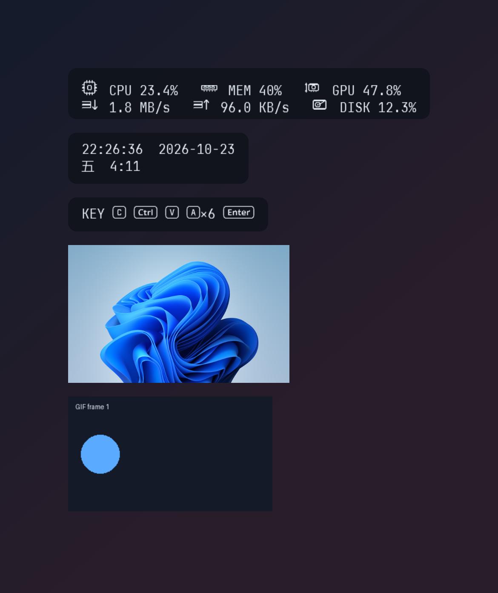
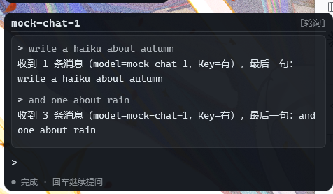

<h1 align="center">MirrorpondHUD · 镜潭一览</h1>

<p align="center">
  <b>可增删的桌面信息卡片：系统数据、时钟、按键、命令行、图片 / 动图 / 视频，各自一张独立小窗，按顺序堆叠在桌面最上层。</b><br>
  <sub>A modular set of always-on-top desktop cards with live hardware stats, a clock, keystroke display, a built-in command line and image / GIF / video cards.</sub>
</p>

<p align="center">
  
  
  
  
  
</p>

<p align="center">
  <a href="#简体中文">简体中文</a> · <a href="#english">English</a>
</p>

<p align="center">
  
</p>

<a id="简体中文"></a>

鼠标默认**完全穿透**，不挡任何点击；卡片、顺序、内容和样式都在设置窗口里调整。

## ✨ 功能

- **卡片化** — 信息与文本 / 命令行 / 媒体 / AI 对话 / 按钮演示五种卡片，可随时添加、删除、上下移动；同一种卡片可以有任意多张，名称也可以重名
- **常驻或呼出** — 每张卡片可以「常驻」在屏幕上，也可以关掉常驻、绑定一个全局热键按需呼出；两张卡片设成同一个热键时，按下会**同时**显示
- **按顺序堆叠** — 设置页里的顺序就是叠层上的顺序；第一张对齐到锚点，其余按各自的「与上方卡片间距」向下排列，解锁后拖动任意一张会移动整叠；「对齐方式」可选自动 / 左对齐 / 右对齐，让所有卡片共线的是卡片边缘而不是文字边缘
- **实时数据** — CPU / GPU / 磁盘 / 网络 / 内存 / 分区空间 / 时间 / 运行时长，PDH 性能计数器采样，独立线程不卡 UI
- **模板化内容** — `{cpu:0.0}%`、`{net_down}`、`{cpu_icon} CPU {cpu:0.0}%`，支持 .NET 格式串与对齐；每张卡片单独编辑内容
- **Reicon 图标** — 内嵌 [ReiconFont](https://github.com/CRITTIof/reicon-font)：87 个键帽字形、软件 / 硬件 / 界面图标；CPU、GPU、RAM、ROM、网络上下行图标已接入信息显示，设置页的页签与增删移动按钮也使用它。图标大小按正文的 1.15 倍（1.0 = 与文字等高），垂直方向按字形墨迹自动居中，不用为了图标把整行字号调大
- **按键显示** — 全局键盘钩子，最近按键、重复折叠（`A×6`）、最大字符数限制，按键以键帽字形显示
- **快捷命令行** — 命令行是一张普通卡片，按自己的热键展开；**工具 / 工作目录 / 超时都在这张卡片自己身上**，所以可以同时放 CMD、PowerShell、WSL 三张卡片各用各的
- **CLI 交互面板** — AI 对话与命令行现在是**同一套面板**（终端版式、同一套角色与滑块）：每一条命令 / 每一轮问答都是一块**内部小面板**，各带自己的滚动条，互不挤占；整块面板的宽度、高度上限、小面板高度、最多保留条数都在「外观 → CLI 交互面板」里调
- **媒体卡片** — 一张卡片显示图片 / 位图 / 动图（GIF）/ 视频，可调缩放方式、宽高、透明度、循环、静音、倍速，并可选择是否按外观的圆角裁圆；卡片顶部显示文件名（过长省略），视频底部带播放进度条；系统解不开的视频会自动改用 ffmpeg
- **AI 对话卡片** — 一张**命令行样式**的终端卡：第一行模型名、第二行 `>` 提示符输入、下面每轮问答各一块内部小面板（各自滚动）。走 OpenAI 兼容接口，**每张卡自己一套**接口地址 / 模型 / Key（所以能同时挂两个模型）；单次（每次不带历史）与轮询（保留上下文连续对话）用全局热键切换，卡片上不放按钮
- **Key 加密** — API Key 用 Windows DPAPI（当前用户）加密后再写进 `settings.json`，文件里只有 `dpapi:…` 密文；设置页也不回显，已填过就显示「已填写 API Key，重新输入以更换」
- **毛玻璃背景** — 三种实现：**系统亚克力**（卡片下面一块独立底板，DWM / GPU 实时模糊身后的桌面与窗口，进程侧零开销）、**兼容**（按像素拼出卡片后面的画面再缩小模糊，任何 Windows 都能用、半径可调）和**桌面亚克力**（DWM 材质底板自己截屏，能糊到动态壁纸 / 视频这类 `PrintWindow` 抓不到的东西，代价是**卡片不会出现在截图里**）。**默认关闭、暂不推荐**——见 [docs/glass-implementations.md](docs/glass-implementations.md)
- **外观可调** — 字体字号、图标倍率、描边、背景图、透明度、圆角、投影、固定宽度；尺寸只增不减，数值变化时不跳动
- **启动动画** — 打字 / 退格动画 + 模拟光标（方块 / 竖线 / 下划线 / 空心框 / 关闭）
- **托盘常驻** — 单实例唤醒、开机自启、可自定义的全局热键、鼠标穿透锁定
- **无依赖** — 单文件 exe，目标机器不需要安装 .NET

## 🚀 快速开始

**下载即用**：到 [Releases](https://github.com/CRITTIof/MirrorpondHUD/releases) 下载最新版 `v2.9.2`。
自 v2.1.0 起只提供**需要手动安装 .NET 8 桌面运行时**的版本（体积小）；先装运行时，再双击 exe：

| 文件 | 适用 | 说明 |
| --- | --- | --- |
| `MirrorpondHUD-x64-requires-dotnet.exe` | 普通电脑（x64） | 需要 [.NET 8 桌面运行时](https://dotnet.microsoft.com/download/dotnet/8.0) |
| `MirrorpondHUD-arm64-requires-dotnet.exe` | Windows on ARM | 需要 [.NET 8 桌面运行时](https://dotnet.microsoft.com/download/dotnet/8.0) |

**从源码运行**：

```bat
git clone https://github.com/CRITTIof/MirrorpondHUD.git
cd MirrorpondHUD
run.bat
```

`run.bat` 会自动编译，然后直接从 `bin\Release` 启动。开机自启会直接显示全部常驻卡片，不受「启动后最小化到托盘」影响。
配置文件和日志也生成在那里（`bin\Release\settings.json`、`bin\Release\mirrorpond.log`）。

## ⌨️ 快捷键

| 操作 | 默认 | 说明 |
| --- | --- | --- |
| 打开设置窗口 | `F10` | 也可左键单击托盘图标 |
| 锁定 / 解锁（鼠标穿透） | `F8` | 所有卡片能否拖动、能否点右键只由它切换；打开 / 关闭设置窗口不会改变锁定状态 |
| 快捷命令行 | `F9` | 属于「命令行」卡片，可在「内容」页改；每张命令行卡片各有一个 |
| 显示 / 隐藏全部 | *未设置* | 从托盘菜单操作，或自行绑定 |
| 每张卡片的呼出热键 | 见设置 | 在「内容」页每张卡片里设置；非「常驻」卡片必须设置，否则保存时会提示 |
| 媒体卡片 | `F11` | 新建的媒体卡默认热键，可在卡片里改 |
| AI 对话：切换单次 / 轮询 | `Ctrl+Alt+Shift+M` | 作用于**所有** AI 对话卡片；在「热键」页改。四键组合是为了躲开被输入法 / 录屏 / IDE 占掉的三键组合 |
| AI 对话：清空上下文 | *未设置* | 同上，在「热键」页自行绑定 |

所有热键都能在设置里改，**留空 = 不启用**；全局热键被其它程序占用时会自动退到 `Ctrl+Alt+原键` 并记入日志。
两张卡片使用同一个组合键是允许的：按键一次，两张卡片同时呼出 / 收起。
再次双击 exe 不会起第二个进程，而是唤醒已在运行的实例的设置窗口。

## 🗂️ 卡片


「设置 → 内容」就是卡片管理器：

- **添加卡片**：点「添加卡片」，从菜单里选一种卡片，新卡片会出现在列表最后
- **展开 / 折叠**：点标题栏或右侧箭头；展开时显示名称、常驻、呼出热键、与上方卡片间距、内容，
  命令行卡在这里设置**自己的**工具与目录，媒体卡在这里选文件与播放方式
- **移动**：点卡片右侧的移动按钮，选择「上移 / 下移」，列表顺序就是叠层上的显示顺序
- **删除**：点垃圾桶按钮，确认后保存并应用才真正移除
- **搜索**：右上角搜索框按名称 / 类型筛选，不影响实际顺序
- **常驻**：勾选后一直显示；取消后必须设置「呼出热键」
- **不再有实时预览**：内容在叠层上直接看效果，设置页只做编辑

五种卡片：

| 卡片 | 内容 | 说明 |
| --- | --- | --- |
| 信息与文本 | 系统信息（CPU / 内存 / GPU / 网络 / 磁盘）、时钟、按键、任意文字 | 一张卡片，用「预设」切换：系统信息 / 时钟 / 按键 / 文本信息；四种内容都支持全部占位符 |
| 命令行 | 提示符 / 历史 / 输入 | 独占键盘，按自己的热键展开；工具与超时是**每张卡片独立**的 |
| 媒体 | 图片 / 位图 / 动图 / 视频 | 顶部文件名、视频进度条；文件、缩放、透明度、解码器都在卡片里 |
| AI 对话 | 模型名 / `>` 输入行 / 终端记录 | 命令行样式；OpenAI 兼容接口，每张卡一套地址 / 模型 / Key；单次 / 轮询走全局热键，Key 用 DPAPI 加密存储 |
| 按钮演示（实验） | 三种语气的按钮 + 输入框回显 | 验证 `CardButton` / `CardTextBox` 与「不点击穿透」的交互卡片 |



媒体卡片和文字卡片共用同一块底层：卡片底色、毛玻璃、圆角、投影都照旧，媒体四周留出和文字一样的内边距，
顶部一行文件名（超长自动省略），视频在底部多一条 250 ms 刷新的进度条。

视频默认交给 Windows 自带的 Media Foundation；放不了（mkv / webm / av1 …）且机器上有 ffmpeg 时，
自动改用它逐帧解码并画回卡片里（**有声音**：音频走第二条 ffmpeg 进程 + winmm 输出，支持变速）。
右上角显示播放 / 暂停状态、当前时长 / 总时长，速度不是 1× 时再追加「· 1.5×」。
设置页的「解码器」可以固定用系统或 ffmpeg，也可以指定自定义 `ffmpeg.exe`；「检测」会重新扫描
PATH 与常见安装目录，把找到的 ffmpeg / mpv / VLC 列出来。

卡片在屏幕上的位置由两部分决定：**锚点**（「行为」页的显示器 / X / Y）和**每张卡片的间距**。
第一张可见卡片对齐锚点，之后依次向下排；非常驻卡片被呼出时也会插入到它自己的位置，其它卡片顺势让开。
「行为」页的「应用位置」只移动整叠，不会改变顺序。

## 🖥️ 快捷命令行

按命令行卡片的热键（默认 `F9`）展开卡片，提示符格式为 `[工具] [工作目录] >`，工具名统一大写，PowerShell 显示为 **PWSH**。

- **每张命令行卡片有自己的工具设置**：CMD / Windows PowerShell / PowerShell 7 / 自定义模板（`{cmd}` 占位），
  外加自己的工作目录、单条输出上限、超时。想同时用 CMD 和 WSL，就加两张命令行卡片，各配各的热键
- 命令在后台线程执行，**每条命令一块内部小面板**：上面是提示符与命令，下面是返回内容，超出「内部小面板最大高度」后
  这块小面板用自己的滚动条滚（不会和其他命令挤在一根滑块上）；返回内容按原文换行显示，不再截断单行
- 默认 20 秒超时，超时强制结束；输出先按 UTF-8 解码，失败退回系统 OEM 代码页（中文不乱码）
- **再按一次该热键（或 `Esc`）退出**，清空命令与返回，卡片收起
- 启动动画期间会先结束动画再打开


输入框里的输入法被刻意关闭（中文输入法开着时回车只会确认候选词，命令发不出去）；支持方向键、`Home` / `End`、`Ctrl+V`、`Ctrl+Z`。
命令行面板的**外观与 AI 对话卡片完全一致**：同一套标题行、状态行、颜色与滚动条，尺寸统一在「设置 → 外观 → CLI 交互面板」里调。

## 🤖 AI 对话卡片

「设置 → 内容 → 添加卡片 → AI 对话」，然后在卡片的「AI 接口」里填**接口地址**（OpenAI 兼容，填到 `/v1` 为止）、
**模型名**、**API Key**。卡片是终端样式：



```
mock-chat-1                                        [轮询]
───────────────────────────────────────────────────────────
┌─────────────────────────────────────────────────────────┐
│ > 介绍一下你自己                                         │
│ 我是……（模型回答）                                       │
│ > 再说细一点                                            │
│ ……（这一轮把上一轮一起发了回去）                          │
└─────────────────────────────────────────────────────────┘
>
● 就绪 · 回车发送 · Ctrl+Alt+Shift+M 切换单次 / 轮询
```

- **单次 / 轮询**：单次每次提问都不带历史；轮询把最近 12 条消息一起发回去。切换用全局热键
  （默认 `Ctrl+Alt+Shift+M`，在「热键 → AI 对话卡片」里改），切模式会清空这张卡的上下文
- **清空上下文**：同一页可以绑一个热键（默认留空）
- 回答期间输入框变只读、焦点留在提示符后面，**连着问不用重新点**；点卡片任意位置也会把焦点拉回输入行
- 上下文只在内存里：卡片隐藏 / 重建 / 重启就清空；每张卡片各带一套上下文，互不影响
- API Key 用 **Windows DPAPI**（当前用户）加密后写进 `settings.json`（`dpapi:…`），文件里没有明文；
  设置页也不回显，已填过就显示「已填写 API Key，重新输入以更换」，旁边的「清除」可以忘记它。
  换 Windows 用户或换机器后解不开，卡片会提示重填；本地服务（LM Studio / Ollama 兼容层）Key 可以留空
- 这张卡需要输入框，所以**不点击穿透**：点一下就能打字，代价是它会挡住身下的桌面点击（其余卡片不受影响）

## 🧩 显示内容与占位符

每张卡片的内容是一段支持多行的模板文本，用 `{变量}` 插入实时数据：

```
{cpu_icon} CPU {cpu:0.0}%   {mem_icon} MEM {mem_pct:0}%
{net_down_icon} {net_down}   {disk_icon} {disk:0.0}%
```

| 变量 | 含义 | 变量 | 含义 |
| --- | --- | --- | --- |
| `{cpu}` / `{cpu_bar}` | CPU 占用 / 进度条 | `{gpu}` / `{gpu_bar}` | GPU 占用 / 进度条 |
| `{mem_pct}` `{mem_used}` `{mem_total}` `{mem_free}` | 内存 | `{gpu_name}` `{gpu_temp}` `{gpu_power}` | 显卡名 / 温度 / 功耗 |
| `{disk}` / `{disk_bar}` | 磁盘活动率 | `{vram_used}` `{vram_total}` `{vram_pct}` | 显存 |
| `{disk_read}` `{disk_write}` | 磁盘读写速度 | `{free_C}` `{total_C}` `{used_pct_C}` | 分区空间（`D` 即 D 盘） |
| `{net_down}` `{net_up}` `{net_total}` | 网络速度 | `{net_adapter}` | 当前网卡名 |
| `{keys}` / `{key_count}` | 最近按键 / 累计次数 | `{time}` `{date}` | 时间 / 日期 |
| `{weekday_zh}` / `{weekday_zh_short}` | 星期（中文：星期一 / 周一） | `{weekday_en}` / `{weekday_en_short}` | 星期（英文：Monday / Mon） |
| `{weekday}` | 星期（跟随系统区域，旧配置沿用） | `{uptime}` `{host}` `{user}` | 运行时长 / 计算机名 / 用户名 |
| `{cpu_icon}` `{gpu_icon}` `{mem_icon}` `{disk_icon}` `{net_up_icon}` `{net_down_icon}` | Reicon 图标 | | |

设置页每张卡片下方都有占位符下拉框，选中即插入到光标处。键盘显示可调数量、折叠阈值与最大字符数（默认 18），
超过上限从最旧的按键开始丢弃（`Back` / `Cap` / `ins` 等特殊键用短名字）。

## ⚙️ 配置

所有设置保存在 exe 同目录的 `settings.json`（源码运行时即 `bin\Release\settings.json`），
保存时自动备份为 `.bak`，损坏时另存 `.broken-时间戳` 并回退默认值；日志 `mirrorpond.log` 与配置同目录。

```json
{
  "SchemaVersion": 4,
  "Overlay": { "X": 1483, "Y": 127, "Monitor": 0, "Locked": true, "CornerRadius": 10 },
  "Style": { "FontFamily": "JetBrains Mono NL", "FontSize": 15, "BackgroundOpacity": 0.3,
             "IconScale": 1.15, "Acrylic": false, "AcrylicBlur": 12, "AcrylicFps": 15 },
  "Cli": { "MaxWidth": 460, "MaxHeight": 420, "EntryMaxHeight": 140, "MaxEntries": 12 },
  "Cards": [
    {
      "Id": "3f6c...",
      "Kind": "metrics",
      "Name": "系统信息",
      "Resident": true,
      "Hotkey": "",
      "Spacing": 0,
      "Content": "{cpu_icon} CPU {cpu:0.0}%   {mem_icon} MEM {mem_pct:0}%",
      "Command": { "Shell": "cmd", "WorkingDirectory": "", "TimeoutSeconds": 20 },
      "Media": { "Path": "", "Fit": "Contain", "Width": 320, "Loop": true, "Muted": true,
                 "Rounded": true, "Decoder": "Auto", "DecoderPath": "" }
    }
  ]
}
```

- `SchemaVersion` 为 3；旧版配置在启动时自动迁移并写回：
  v0/v1 单窗口配置（全局 `Content` + `X/Y/Visible`）拆成多张卡片，
  v2 的全局命令行工具设置复制进每张命令行卡片
- `Cards` 的顺序就是叠层顺序；`Spacing` 是与上一张可见卡片的间距
- `Resident=false` 的卡片必须有 `Hotkey`，否则保存时会提示
- `Command` 属于每张命令行卡片：工具、自定义模板、工作目录、行截断、行数、超时
- `Media` 属于每张媒体卡片：文件、缩放（`Contain` / `Cover` / `Fill` / `None`）、宽高、透明度、循环、自动播放、静音、倍速、圆角（`Rounded`）、解码器（`Decoder`：`Auto` / `BuiltIn` / `FFmpeg`）与自定义 `DecoderPath`
- 外观（`Style`）是**全局**的：所有卡片共用字体、颜色、背景、图标倍率、毛玻璃等，卡片只负责内容与位置

## 🔨 编译

需要 .NET 8 SDK：

```bat
dotnet build MirrorpondHUD.csproj -c Release
```

输出在 `bin\Release\MirrorpondHUD.exe`。`build.bat` 会编译并调用 `sign.ps1` 做本地签名；
`publish.bat` 生成四个单文件 exe（x64 / ARM64 × 自带运行时 / 依赖运行时）。

```bat
run.bat            :: 编译并运行
build.bat          :: 只编译
publish.bat        :: 生成 publish\ 下的四个单文件
```

## 🩺 故障排查

- **按键不显示** — 先看日志里「键盘钩子：已安装」；以管理员身份运行的程序会拦住普通权限程序的全局钩子，反之亦然。程序被放在受控目录、以低完整性级别运行时，Windows 会拒绝键盘钩子、托盘和全局热键
- **中文乱码** — 命令行输出先按 UTF-8 解码，失败再按系统 OEM 代码页；若是 `chcp 65001` 的旧程序，可在命令前自行加 `chcp 936`
- **热键没反应** — 多半被其它程序占用。全局热键会自动退到 `Ctrl+Alt+原键`；卡片热键注册失败会在托盘气泡和日志里提示，换一个组合键即可
- **卡片不见了** — 检查「内容」页是否取消了「常驻」且没设热键；「显示 / 隐藏全部」也可能整体隐藏了叠层
- **日志与配置** — `bin\Release\mirrorpond.log`、`bin\Release\settings.json`

## ⚠️ 已知限制

- 多张命令行卡片各自独立：各自的历史、输入、工具与超时（历史在面板自己身上，收起时清空），
  但**同一时间只有一张能处于输入状态**
- CLI 面板（AI 对话 / 命令行）的宽度由「外观 → CLI 交互面板 → 最大宽度」决定，不再按文字长度自动量宽；
  每条记录各带自己的滚动条，整块面板超过「最大高度」后由外层滚动条接管
- 卡片结构（增删 / 排序 / 常驻 / 热键 / 内容）和外观都在「保存并应用」后生效
- 媒体卡片的视频优先用系统 Media Foundation 解码；解不开（mkv / webm / av1 …）且检测到 ffmpeg 时，
  自动改用 ffmpeg 逐帧解码并画回卡片。系统解码路径用 `MediaElement` 自己的声音；ffmpeg 路径的
  声音由第二条 ffmpeg 进程转成 PCM、经 winmm 输出，两端都支持 0.25–4× 变速
- 视频子窗口在跟随卡片的独立窗口里播放（分层窗口画不出 `MediaElement`），因此视频区域不支持卡片内拖动、点击
- AI 对话卡片、命令行卡片和按钮演示卡片需要收鼠标 / 键盘，所以**不点击穿透**：鼠标落在卡片上的点击不会传给桌面（其余卡片照旧穿透）
- AI 对话的上下文只在内存里：卡片隐藏、重建或重启就清空；轮询模式最多带最近 12 条消息
- API Key 用 DPAPI（当前用户）加密存储，**换 Windows 用户或换机器后解不开**，需要重新填写；`settings.json` 里只有密文
- 模型回答目前是**非流式**（整段返回后才显示），没有打字机效果
- **毛玻璃暂时不推荐开启（默认关闭）**。系统亚克力靠未文档化的 DWM 接口，圆角卡片会露直角补角、
  亮度只由色调决定；兼容实现每帧对身后每个窗口做 `PrintWindow`，5 张卡实测约 40% 单核，且抓不到动态壁纸 /
  独占全屏。第三条「桌面亚克力」自己截屏 + 模糊，再把结果画进卡片内容层（4 张卡约 3–8% 单核，可调帧率，能糊到动态壁纸和视频），
  代价是**开了它卡片就不会出现在截图 / 录屏里**——自截屏必须把自己排除在捕获之外；取图默认走 DXGI 桌面复制，模糊强度 / 刷新帧率 / 取图方式都在
  **设置 → 外观 → 高级（实验性）** 里可调。三条路的实测与选择建议见
  **[docs/glass-implementations.md](docs/glass-implementations.md)**。只想要半透明卡片的话，把「背景不透明度」
  调到 0.5–0.7 即可，没有额外开销
- 运行期插件（`cards/*.dll`）暂未实现；加一种卡片只需在 `src/Cards` 新增一个类——文字卡继承 `CardModuleBase`，
  图片 / 视频这类富内容卡继承 `RichCardModuleBase`，宿主不用改

## 🗂️ 目录结构

```
src/
  App.xaml(.cs)          入口、单实例、命令行参数
  Cards/                 卡片模块：ICardModule / IRichCardModule / 各卡片
  Core/                  设置、迁移、JSON、日志、图标、键帽映射
  Media/                 图片 / 动图 / 视频控件、视频子窗口、解码器探测与 ffmpeg 解码
  Metrics/               PDH / nvidia-smi 采样
  Text/                  模板引擎、占位符、按键名、命令执行
  Ui/                    叠层窗口、绘制、毛玻璃（GlassBackdrop / GlassCapture）、设置窗口、托盘、热键、自启
docs/                    设计文档与截图
assets/keycaps/          ReiconFont 与映射文档
tools/                   开发脚本（make_logo.py 生成多尺寸 logo.ico），不参与构建
```

设计资料：

- [docs/cards-architecture.md](docs/cards-architecture.md) — 模块化卡片架构、富内容契约与扩展方式
- [docs/modularity-review.md](docs/modularity-review.md) — 模块化现状评审：扩展点盘点、P0 / P1 / P2 问题清单（含文件行号）与分阶段落地路线
- [docs/glass-implementations.md](docs/glass-implementations.md) — 毛玻璃的两种实现（系统亚克力 / 截屏取样）：各自的毛病与实测数据，中英双语
- [docs/theme-system.md](docs/theme-system.md) — 外观主题方案：`.mptheme` 单文件格式、字段映射、导入 / 导出与回滚流程（草案 + 三份示例主题）
- [docs/theme-rewrite-prerequisites.md](docs/theme-rewrite-prerequisites.md) — 外观重写的前置：令牌层 / CLI 面板换肤 / 主题文件 / 设置页入口的分步计划与验收清单（附仓库历史文件审计）
- [docs/theme-motion.md](docs/theme-motion.md) — 主题的动效与控件样式调研：启动动画参数化、出现 / 消失 / 让位动画、按钮面板滑块 token 与受控模板、设置页换肤（含分层窗口动画实测）
- [docs/version-history.md](docs/version-history.md) — v2.4.1 → v2.9.3 每个版本改了什么、动了哪些文件（含实测数据与提交号）
- 「热键」页：全局三个热键置顶；媒体卡片单独一组（播放 / 暂停、前进、后退、加速、减速），
  由卡片模块自己声明，新增卡片类型可以注册自己的通用热键

## 📄 许可与字体致谢

本项目以 **MIT** 许可发布，见 [LICENSE](LICENSE)。

按键与图标字体来自 [ReiconFont](https://github.com/CRITTIof/reicon-font)，以 **SIL Open Font License 1.1** 发布，
许可原文见 `assets/keycaps/OFL.txt`；87 个键帽与 27 个图标的码位见 `assets/keycaps/MAPPING.md`。

---

<a id="english"></a>

# MirrorpondHUD

**A modular always-on-top desktop HUD.** Each card is an independent transparent window: system stats, clock, keystrokes, free-form text, a command line, or an image / GIF / video. Cards can be added, removed, reordered, pinned as resident, or summoned with their own global hotkey.

<p align="center">
  
</p>

## Features

- **Card modules** — info & text, command line, media, AI chat and a button demo; add / delete / reorder from *Settings → Content*, duplicates allowed
- **Resident or hotkey** — a card is either always visible, or hidden until its own hotkey is pressed; two cards may share one hotkey and appear together
- **Stack layout** — list order is screen order; the first card is anchored at a monitor-relative X/Y, every following card keeps its own gap to the previous one; dragging any card moves the whole stack. *Alignment* (auto / left / right) lines up card edges, not text, and *auto* switches sides with the half of the screen the stack sits on
- **Live metrics** — CPU / GPU / disk / network / memory / drives / uptime through PDH counters on a background thread
- **Templated content** — `{cpu:0.0}%`, `{net_down}`, `{cpu_icon} CPU {cpu:0.0}%`; every card has its own template
- **Reicon icons** — embedded [ReiconFont](https://github.com/CRITTIof/reicon-font) keycaps and icons. Icons render at 1.15× the text size (1.0 = same height as text) and are vertically centred by their ink bounds — no need to inflate the whole line
- **Click-through** — the overlay never blocks the desktop unless unlocked with `F8`
- **Command line cards** — each card owns its tool, working directory, output cap and timeout, so a CMD card, a PowerShell card and a WSL card can coexist
- **CLI panels** — the AI chat and command line cards now share one panel: terminal layout, the same colours and scrollbars. Every command / every Q&A round is its own inner panel with its own scrollbar, so records never fight over one thumb; panel width, height cap, inner-panel cap and how many records to keep live under *Appearance → CLI panel*
- **AI chat card** — a terminal-styled card: model name on the first line, a `>` prompt input line, one inner panel per Q&A round below. Any OpenAI-compatible endpoint; each card owns its base URL, model and key, so two models can run side by side. Single shot vs. context chat is switched with a global hotkey (no buttons on the card)
- **Encrypted key storage** — API keys are encrypted with Windows DPAPI (current user) before being written to `settings.json`, which only holds `dpapi:…` blobs; the settings field never echoes the key, it shows *API Key already set, type a new one to replace*
- **Media cards** — one card per image / bitmap / animated GIF / video, with fit mode, size, opacity, loop, mute, speed and an optional corner-rounding toggle; the card keeps the text-card backing and adds a filename header plus a progress bar under videos; Media Foundation decodes first and ffmpeg takes over when it cannot
- **Frosted glass** — three implementations: **system acrylic** (a separate backdrop window under each card, blurred live by DWM / the GPU at zero cost in this process), **compat** (windows behind the card are composed per pixel, downscaled and blurred; adjustable radius, works on any Windows) and **desktop acrylic** (a DWM material backdrop that captures the screen itself, so it can blur animated wallpapers and video that `PrintWindow` cannot see — at the cost of the cards never appearing in screenshots). **Off by default and not recommended yet**, see [docs/glass-implementations.md](docs/glass-implementations.md)
- **No runtime needed** — self-contained single-file builds for x64 and ARM64

## Quick start

Download the latest release from [Releases](https://github.com/CRITTIof/MirrorpondHUD/releases) (`MirrorpondHUD-x64-requires-dotnet.exe` is the usual choice; since `v2.1.0` only framework-dependent builds are published, so install the [.NET 8 Desktop Runtime](https://dotnet.microsoft.com/download/dotnet/8.0) first), or build from source:

```bat
git clone https://github.com/CRITTIof/MirrorpondHUD.git
cd MirrorpondHUD
run.bat
```

`run.bat` builds into `bin\Release` and starts the app; settings and `mirrorpond.log` live next to the exe.

## Hotkeys

| Action | Default |
| --- | --- |
| Open settings | `F10` |
| Lock / unlock (click-through) | `F8` |
| Command line card | `F9` (configurable per card) |
| Show / hide everything | unbound |
| Per-card summon | configured in *Content* |
| Media card | `F11` (default for a new media card) |
| Media playback | play/pause, forward/backward 5 s, faster/slower — set in *Hotkeys → 卡片* |
| AI chat: toggle single / context | `Ctrl+Alt+Shift+M` (applies to every chat card; four keys on purpose, three-key combos tend to be taken) |
| AI chat: clear context | unbound — set in *Hotkeys* |

Global hotkeys fall back to `Ctrl+Alt+<key>` when occupied; card hotkeys do the same and the fallback is written back to the card. Duplicates are allowed and summon all matching cards.

## AI chat cards


*Settings → Content → Add card → AI chat*, then fill in the base URL (OpenAI-compatible, up to `/v1`), the model name and the API key. The card is a terminal: the first line shows the model (and `[单次]` / `[轮询]`), the `>` line is the input, the framed area below is the transcript — your lines are dim and prefixed with `>`, answers are bright.

Single shot sends only the current question; context keeps the last 12 messages. Both are switched with the global hotkey (`Ctrl+Alt+Shift+M` by default, rebindable in *Hotkeys → AI 对话卡片*); switching clears that card's history and is saved immediately. Clearing the context has its own optional hotkey.

While a request is in flight the input becomes read-only instead of disabled, so the caret stays in the prompt and you can ask the next question without clicking again; clicking anywhere on the card also returns focus to the prompt. History lives in memory only, per card. API keys are DPAPI-encrypted (current user) — see the feature list above.

## Media cards


Images, bitmaps and animated GIFs are drawn inside the layered card window; video uses a companion window because WPF cannot composite `MediaElement` into a `WS_EX_LAYERED` window. The media card keeps the same backing as a text card (tint, glass, rounded corners, shadow) and adds a filename header (ellipsized when long) plus a progress bar under videos. Fit (`Contain` / `Cover` / `Fill` / `None`), size, opacity, loop, autoplay, mute, playback speed, corner rounding and the decoder are stored per card. Video is decoded by Windows Media Foundation first; when that fails (mkv / webm / av1 …) and ffmpeg is available, the card falls back to decoding frames with ffmpeg — including audio (a second ffmpeg process feeds 48 kHz PCM to winmm) and speed changes. The header shows the play/pause state, current / total time and the speed when it is not 1×. The decoder row in the settings offers `Auto` / system only / ffmpeg only, a custom `ffmpeg.exe`, and a **Detect** button that rescans `PATH` and common install folders for ffmpeg / mpv / VLC.

## Configuration

Everything is stored in `settings.json` next to the executable (`SchemaVersion: 3`). Older configs are migrated on first launch and written back: v0/v1 single-overlay configs are split into cards, and the v2 global command settings are copied into every command card. `Cards[]` holds `Id`, `Kind`, `Name`, `Resident`, `Hotkey`, `Spacing`, `Content`, plus a per-card `Command` block (tool / template / working directory / truncation / timeout), a per-card `Media` block (file / fit / size / opacity / loop / mute / speed) and a per-card `Chat` block (base URL / model / encrypted key / mode / system prompt / timeout / width). The list order is the on-screen order; appearance stays global.

## Known limitations

- Only one command card can be in input mode at a time; history and settings are per card
- Video falls back to ffmpeg when Media Foundation cannot decode it; both paths play audio and support 0.25–4× speed. Video needs the companion window, so the video area does not participate in drag or click handling
- The AI chat card, the command line card and the button demo card take mouse / keyboard input, so they are **not click-through**: clicks inside them no longer reach the desktop (other cards still are)
- AI chat history is memory only — hiding, rebuilding or restarting clears it; context mode carries at most the last 12 messages
- API keys are DPAPI-encrypted for the current Windows user, so they **cannot be decrypted after switching user or machine** and have to be re-entered; `settings.json` holds ciphertext only
- Answers are **not streamed** yet (the whole reply appears at once, no typewriter effect)
- **Frosted glass is off by default and not recommended yet.** The system-acrylic path leans on an
  undocumented DWM call, shows square corner slivers under rounded cards and takes its brightness from the
  tint only; the compat path calls `PrintWindow` for every window behind every card each frame (≈ 40% of one
  core with 5 cards), and cannot see animated wallpapers or exclusive-fullscreen windows. The third path,
  *desktop acrylic*, uses a DWM material backdrop that captures the screen itself (≈ 3% of one core for 4
  cards, and it does blur animated wallpapers and video), but **while it is active the cards do not appear in
  screenshots or recordings** — a self-capturing window has to exclude itself. Measured numbers, the full list
  of flaws and how to choose: **[docs/glass-implementations.md](docs/glass-implementations.md)** (bilingual).
  If all you want is a translucent card, set *Background opacity* to 0.5–0.7 — it costs nothing
- Runtime plugins (`cards/*.dll`) are not implemented; adding a card is one new class in `src/Cards` (text cards derive from `CardModuleBase`, rich cards from `RichCardModuleBase`)

## Build

```bat
dotnet build MirrorpondHUD.csproj -c Release
publish.bat        :: four self-contained / framework-dependent single-file builds
```

## Credits and license

MIT — see [LICENSE](LICENSE). Keycap and icon glyphs come from [ReiconFont](https://github.com/CRITTIof/reicon-font), licensed under the SIL Open Font License 1.1 (`assets/keycaps/OFL.txt`, mapping in `assets/keycaps/MAPPING.md`).

Design notes: [docs/cards-architecture.md](docs/cards-architecture.md) (module contract, rich cards, per-card settings) and [docs/glass-implementations.md](docs/glass-implementations.md) (the two frosted-glass implementations, their flaws and the measurements behind them).
