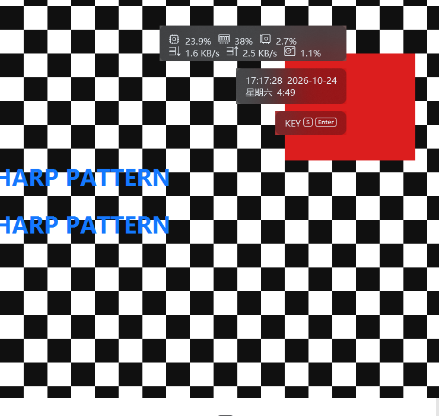
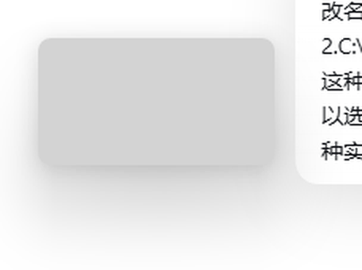

# 毛玻璃：三种实现的取舍（以及为什么默认不推荐）

<a id="中文"></a>

**一句话**：毛玻璃是这个项目里唯一「没有正确答案」的功能。三条实现都能跑，各有硬伤，所以它**默认关闭**，
也不建议为了观感去开。只想要半透明卡片的话，把「背景不透明度」调到 0.5–0.7 就够了，没有任何额外开销。

> 本文只讲**现在**这三条路。历史调研（WGC / WinUI 3 / DWM 文档化材质逐项试错）没有随仓库发布。

## 1. 三条路

| | 系统亚克力（默认） | 兼容（截屏取样） | 桌面亚克力（DWM 底板） |
| --- | --- | --- | --- |
| 做法 | 卡片下面一个**从不绘制的 HWND**，挂未文档化的 `WCA_ACCENT_POLICY = ACRYLICBLURBEHIND`，DWM 在那个矩形里实时模糊 | 枚举卡片矩形内的外部窗口 → `PrintWindow` 逐层取图 → 按像素取「盖住这点的最上层」→ 缩小、多次盒式模糊 | 卡片下面一个**非分层**的 HWND，挂文档化的 `DWMWA_SYSTEMBACKDROP_TYPE = DWMSBT_TRANSIENTWINDOW` + DWM 圆角；材质对非活动窗口不生效，所以底板自己 `BitBlt` 截屏 + 模糊（200 ms 一帧） |
| 谁在干活 | DWM / GPU | 本进程（后台线程 + 定时器） | 本进程（200 ms 截屏 + CPU 模糊） |
| 实测 CPU | **1.5–2.2%** 单核，5 张卡（≈ 关闭毛玻璃的 1.6%） | **≈ 41%** 单核，5 张卡 15 fps（纯壁纸背景时 8–14%） | **3.1%** 单核，4 张卡 |
| 模糊程度 | 由系统决定，不可调 | 0–40px 可调，帧率 2–30 可调 | 固定（缩略图上 9px ≈ 原图 18px），不可调 |
| 抓得到什么 | DWM 合成后的屏幕（动态壁纸 / 视频也糊得出来） | 各窗口**自身内容**（`PrintWindow` 抓不到的就没有） | DWM 合成后的屏幕（动态壁纸 / 视频也在） |
| 截图 / 录屏 | 正常 | 正常（不抓屏，也不会把自己拍进去） | **卡片完全不会出现**（自截屏必须把自己排除在捕获之外） |

## 2. 系统亚克力的毛病

1. **未文档化接口**。`SetWindowCompositionAttribute` 是私有 API，微软随时可能改掉。
   调用失败会自动退回兼容实现，但「某天更新完突然变成另一种观感」是这个方案自带的。
2. **圆角卡片会露直角补角**。accent 的模糊区域永远是**窗口矩形**，既不吃 `SetWindowRgn`，
   也不吃 DWM 的圆角偏好。圆角半径超过约 12px 后，卡片四个角外面会露出没有 tint 的方形玻璃：

   

3. **亮度来自色调，不来自壁纸**。DWM 亚克力的 alpha 基本被忽略，玻璃的**亮度**由 `GradientColor`
   决定（它只透出背后的色相）。所以深色卡片永远是烟灰色，压在浅色壁纸上会显得发闷。
4. **系统开关直接决定成败**。关闭「透明效果」、远程桌面、高对比度都会退化成纯色，需要自动回退。
5. **每张卡多一个 HWND**，且 Win10 上只有理论可用性，没有真机矩阵验证。



*深色卡片（`#0D1117`，不透明度 0.30）：棋盘被糊成柔和明暗带（说明真的在模糊），红块的色相透得出来，
但亮度基本不变 —— 第 3 条就是这个意思。*

## 3. 兼容实现的毛病

1. **CPU 是实打实的**。每帧对每个窗口做一次 `PrintWindow`，再逐点合成、缩小、模糊。
   卡片越多、玻璃越大、身后的窗口越大，开销线性上升（上表：41% 单核）。
2. **取的是各窗口自身内容，不是合成后的画面**。被遮挡的部分取不到，窗口之间的层级只能靠枚举出来的
   z 序近似。
3. **抓不到的东西**：本进程自己的窗口（设置窗口、视频窗）不参与；动态壁纸（Wallpaper Engine 这类
   D3D 交换链窗口）`PrintWindow` 返回全黑，只能退回静态壁纸；独占全屏 / 硬件覆盖层同理。
4. **有延迟感**。15 fps 在拖动窗口或滚动网页时看得出来，调高帧率只会更贵。

## 4. 桌面亚克力底板：能用，但截图里看不到卡片

这条是从 `C:\Coding\acrylic-multiwindow` 移植的：每张卡片下面一块**非分层**的底板窗口，挂**文档化的**
`DWMWA_SYSTEMBACKDROP_TYPE = DWMSBT_TRANSIENTWINDOW`（Windows 11 桌面亚克力）加
`DWMWA_WINDOW_CORNER_PREFERENCE` 圆角。它在那边成立，在这里只能算「能用」，原因有三条：

1. **DWM 只给「当前活动窗口」画这层材质。** 卡片是分层窗口，底板又永远不会成为活动窗口，
   所以底板在屏幕上的样子是一块 **`#D3D3D3` 的圆角灰板**，背后没有模糊：

   

2. **于是底板自己截屏。** 这是 multiwindow 项目的 `PersistentAcrylic` 思路：`BitBlt` 屏幕对应区域
   → 缩到 1/2 的 DIB → 两遍方框模糊 → `StretchBlt` 画回窗口，200 ms 一帧。糊出来的内容长这样
   （卡片压在红 / 绿色块上，半边红半边绿被糊成渐变）：

   

   > **这里踩过一个坑**：DIB 建好之后必须 `SelectObject` **选进内存 DC**，否则 `StretchBlt` 画在 DC
   > 默认的 1×1 单色位图上，采样永远是**全黑**。第一版漏了这一步，看起来就像「DWM 不支持」，
   > 补上之后采样亮度 90–250，玻璃正常。

3. **必须把自己排除在捕获之外。** 否则截屏会把底板 / 卡片的上一帧拍回玻璃里，形成拖影。
   所以底板和卡片都设 `SetWindowDisplayAffinity(WDA_EXCLUDEFROMCAPTURE)`。

**这就是这个方案真正的代价，也是它的定义性缺点**：只要它在生效，**卡片就不会出现在任何截图 / 录屏里**
—— 截图工具、录屏软件、发给别人看的截图，都只有卡片背后的桌面。这不是 bug，是「自己截屏」这条路
绕不开的取舍。

其它已知限制：

- 进程侧每 200 ms 截屏 + 模糊：4 张卡 3.1% 单核（系统亚克力 1.6%，兼容实现 41%）；
  整叠卡片区域只从屏幕读一次，各底板再从内存里取自己那一块（一次屏读 ≈ 一个 vsync）；
- 切窗口 / 最小化 / 弹窗时不只是等下一轮定时器：挂 `SetWinEventHook` 监听
  `EVENT_SYSTEM_FOREGROUND` / `MINIMIZE` / `MOVESIZEEND` / `SWITCHEND` 与 `OBJECT_SHOW` / `HIDE`，
  一有窗口栈变化立刻补帧（+40 ms 再补一帧）。实测玻璃落后屏幕：**30 ms**（改之前 163 ms）；
- 模糊半径固定（缩略图 9px ≈ 原图 18px）、刷新固定 200 ms，不像兼容实现那样可调；
- 底板的圆角是 DWM 的 8px，和卡片自己的圆角（默认 10px）不完全一致，角上会多出一点玻璃；
- 只截卡片这一块屏幕，卡片移动时要重截（已经这么做了），所以拖动时玻璃会比系统实现晚半拍；
- 卡片名下的子窗口（视频窗是 owner 为卡片的独立窗口）也会一起排除，所以这个模式下**视频同样不进截图**。

安全网：连续 3 帧采样全黑（比如系统以后又把截屏挡掉）会**自动退回系统亚克力**，日志写明原因：

```
[INFO] 毛玻璃改用 DWM 桌面亚克力底板：底板自己截屏模糊，卡片与底板都会从截图里消失
[WARN] DWM 桌面亚克力底板不可用（底板截屏全黑：…），毛玻璃退回系统亚克力底板
```

## 5. 所以要怎么选

- **先别开**。需要「卡片像玻璃」的观感，只调「背景不透明度」就能拿到 90% 的效果，CPU 为 0。
- 一定要开、又要能截图：用**系统亚克力**（默认），并把圆角控制在 12px 以内。
- 圆角必须很大、或者需要在 Win10 / 远程桌面上稳定一致：切**兼容**，把帧率降到 8–10、
  模糊 8–12px，并且只留一两张卡片开玻璃。
- 想糊到**动态壁纸 / 视频 / 硬件加速窗口**（兼容实现抓不到），并且**接受卡片不进截图**：
  才用**桌面亚克力**。
- 切换位置：设置 → 外观 → 高级（实验性）→「玻璃实现」。

---

<a id="english"></a>

# Frosted glass: the three implementations, and why it stays off by default

**Short version:** frosted glass is the one feature in this project with no clean answer. All three paths run,
each with flaws this project cannot fix, so it ships **disabled**. If all you want is a translucent card, set
*Background opacity* to 0.5–0.7 — that costs nothing.

This page covers the three paths that exist **now**; the older research (WGC, WinUI 3, the documented-DWM-material
experiments) is not published with the repository.

## 1. The three paths

| | System acrylic (default) | Compat (screen sampling) | Desktop acrylic (DWM backdrop) |
| --- | --- | --- | --- |
| How | A never-drawn HWND under each card with the undocumented `WCA_ACCENT_POLICY = ACRYLICBLURBEHIND`; DWM blurs that rectangle live | Enumerate the windows behind the card → `PrintWindow` each of them → pick the topmost layer per pixel → downscale and box-blur | A **non-layered** HWND under each card with the documented `DWMWA_SYSTEMBACKDROP_TYPE = DWMSBT_TRANSIENTWINDOW` plus DWM rounded corners; the material does not apply to inactive windows, so the backdrop `BitBlt`s the screen and blurs it (one frame per 200 ms) |
| Who pays | DWM / GPU | This process (worker thread + timer) | This process (a screen capture and a CPU blur every 200 ms) |
| Measured CPU | **1.5–2.2%** of one core, 5 cards (≈ 1.6% with glass off) | **≈ 41%** of one core, 5 cards at 15 fps (8–14% over a plain wallpaper) | **3.1%** of one core, 4 cards |
| Blur amount | Chosen by the system | 0–40 px, 2–30 fps, both adjustable | Fixed (9 px on the downscaled copy ≈ 18 px at full size) |
| What it captures | The composed screen (animated wallpapers and video included) | Each window's **own contents** (whatever `PrintWindow` refuses is missing) | The composed screen (animated wallpapers and video included) |
| Screenshots / recording | Normal | Normal (it never captures the screen) | **Cards never show up** (a self-capturing window must exclude itself) |

## 2. What is wrong with system acrylic

1. **Undocumented API.** `SetWindowCompositionAttribute` is private; Microsoft may change it in any release.
   Failures fall back to compat automatically, but "the look changed after an update" is baked in.
2. **Rounded cards show square corner slivers.** The accent region is always the **window rectangle** — it
   honours neither `SetWindowRgn` nor DWM's corner preference. Above ~12 px radius the four corners show
   untinted glass: see `glass-system-corner.png` above.
3. **Brightness comes from the tint, not the wallpaper.** DWM acrylic mostly ignores alpha; the gradient
   colour sets the brightness and only the hue comes through.
4. **System switches decide everything.** "Transparency effects" off, remote desktop, or high contrast
   degrade the material to a flat fill and force a fallback.
5. **One extra HWND per card**, and Windows 10 support is theoretical.

## 3. What is wrong with the compat path

1. **The CPU cost is real.** Every frame calls `PrintWindow` for every window, then composites per pixel,
   downscales and blurs — linear in cards, glass area and window size (41% of one core above).
2. **It samples window contents, not the composed screen.** Occluded areas cannot be recovered.
3. **What it cannot see:** this process's own windows; animated wallpapers (D3D swap chains return black from
   `PrintWindow`); exclusive fullscreen and hardware overlays.
4. **It feels laggy.** 15 fps is visible while dragging or scrolling, and raising the frame rate only costs more.

## 4. Desktop acrylic: it works, but cards are invisible to capture

Ported from `C:\Coding\acrylic-multiwindow`: a **non-layered** backdrop HWND per card using the **documented**
`DWMWA_SYSTEMBACKDROP_TYPE = DWMSBT_TRANSIENTWINDOW` (Windows 11 desktop acrylic) plus
`DWMWA_WINDOW_CORNER_PREFERENCE` rounding. Three things follow:

1. **DWM paints this material only for the active window.** Cards are layered windows and the backdrop never
   becomes active, so on its own the backdrop is a **`#D3D3D3` rounded plate** with no blur behind it
   (`glass-dwm-plate.png`).
2. **So the backdrop captures the screen itself** — the `PersistentAcrylic` idea from that project: `BitBlt`
   the region → a half-size DIB → two box-blur passes → `StretchBlt` back into the window, once per 200 ms
   (`glass-dwm-sample.png` shows what it captures and blurs).

   > **One trap that cost a debugging session**: the DIB must be **selected into the memory DC** with
   > `SelectObject`. Without it `StretchBlt` draws into the DC's default 1×1 monochrome bitmap and every
   > sample is **black** — which looks exactly like "DWM does not support this". With the selection in place
   > the samples read 90–250 and the glass looks right.

3. **It must exclude itself from capture**, otherwise the previous frame is captured back into the glass.
   Both the backdrop and the card get `SetWindowDisplayAffinity(WDA_EXCLUDEFROMCAPTURE)`.

**That is the defining cost:** while this mode is active, **cards do not appear in any screenshot or screen
recording**. That is not a bug — it is inherent to capturing the screen from a window that has to sit in it.

Other limits: 3.1% of one core for 4 cards (system acrylic 1.6%, compat 41%); the blur radius (9 px on the
half-size copy) and the 200 ms interval are fixed; the backdrop's corners are DWM's 8 px, slightly tighter than
the card's own radius, so a sliver of glass can show at the corners. If the capture goes black for three frames
in a row, the mode **falls back to system acrylic automatically** and says why in the log.

## 5. So what should you do

- **Leave it off.** Opacity alone gets you 90% of the look for zero CPU.
- Want glass *and* screenshots: use **system acrylic** (the default) with a radius of 12 px or less.
- Need a large radius, or consistent behaviour on Windows 10 / remote desktop: **compat**, 8–10 fps,
  8–12 px blur, and only one or two cards with glass on.
- Need to blur an **animated wallpaper, a video, or a GPU-accelerated window** (things `PrintWindow` cannot
  see) and can live without cards in your screenshots: **desktop acrylic**.
- Switch it in *Settings → Appearance → Advanced (experimental) → Glass implementation*.
